# GitHub cloud-agent SDLC template

Turn an application-brief issue into requirements, design, a dependency-aware
backlog, implementation, QA and security PRs. GitHub Actions orchestrates the
eight custom Copilot agents; **a human reviews and merges every PR**.
There is no required application language, framework, hosting provider or model.
Python is used only for template automation.

## Quickstart

1. Create a repository from this template. Complete the administrator checklist
   in [setup](docs/setup.md); repository secrets, labels, rulesets and settings
   do **not** automatically transfer as working configuration.
2. Configure Copilot access, Actions, `SDLC_TOKEN` in the default-branch-only
   `sdlc-control` environment, and repository variable
   `SDLC_ENABLED=true`. Set both `SDLC_REQUIRE_DEPENDENCY_REVIEW` and
   `SDLC_CODEQL_ENABLED` to the exact string `true` or `false`; unset fails.
   Prefer `true` where entitled; `false` requires the documented policy and
   alternative controls.
3. Run **SDLC Setup** (`.github/workflows/sdlc-setup.yml`) to initialize labels.
4. A repository writer creates the first **Application brief** issue and adds
   `sdlc:start`. Describe the actual product, users, constraints and success
   criteria; do not put credentials in an issue.
5. Review each assigned agent PR, mark it ready when appropriate, resolve
   blockers, and merge it manually. The controller advances only on verified
   merge evidence. Additional briefs queue; only one pipeline runs at a time.

```mermaid
flowchart LR
    Brief[Writer-labeled brief] --> Requirements[1 Requirements]
    Requirements --> Design[2 Design]
    Design --> Backlog[3 Backlog]
    Backlog --> Plan[3.5 Deterministic plan]
    Plan --> Bootstrap[4 Tooling bootstrap]
    Bootstrap --> Tasks[4 Implementation or 5 Frontend tasks]
    Tasks --> QA[6 QA]
    QA --> Security[7 Security and remediation]
    Security --> Complete[Controller verifies completion]
```



Every arrow between work stages requires a human-merged PR. Repair comments
are bounded to three attempts per PR across all heads; exhausted retries or
unresolved decisions pause progress for a writer.
Advancement also requires a current-head Copilot PR review verified through
the review API, not internal self-review. Requirements blockers need a later
writer `SDLC_UNBLOCKED:` comment on the same assignment issue or PR, followed by
manual resume; resume alone does not clear them.

## What is included

| Path | Purpose |
| --- | --- |
| `.github/agents/` | Eight preserved SDLC agent identities and duties |
| `.github/copilot-instructions.md` | Shared delivery and safety contract |
| `.github/workflows/sdlc-controller.yml` | Trusted GitHub-only orchestration |
| `.github/workflows/sdlc-setup.yml` | Label initialization |
| `.github/sdlc/` | Machine-readable controller/toolchain contracts |
| `.github/sdlc/ruleset.example.json` | Disabled default-branch ruleset example to review/import |
| `scripts/` and `tests/` | Deterministic planning, validation and controller tests |
| `templates/` | BRD, design, epic/story/task, QA and security structures |
| `.github/ISSUE_TEMPLATE/` | Brief and task intake |
| `docs/` | Adoption, operation, contracts, adaptation and release guides |

Generated application artifacts include `docs/requirements/`,
`docs/design/`, `backlog/`, `docs/testing/` and `docs/security/findings.json`.
The original brief is preserved; the controller-owned issue comment, not
generated waves or issue titles, is the runtime source of truth.

## Validate locally

Use Python 3.12 for the template CI baseline (3.14 is also covered by the
pinned tooling hashes). If `python` is not on your PATH, create/activate a local
environment using `python3`; the commands below assume it is active:

```sh
python3 -m venv .venv
source .venv/bin/activate
python -m pip install --require-hashes -r scripts/requirements-checks.txt
```

On Windows activate with `.venv\Scripts\Activate.ps1` in PowerShell. Then:

```text
python scripts/check.py
python -m unittest discover -s tests -v
python scripts/toolchain.py --gate validate
python scripts/toolchain.py --gate all
```

Workflow syntax is additionally checked in CI with checksum-pinned actionlint.
On Linux x64 or macOS arm64, run `python scripts/validate-workflows.py` locally;
other local platforms can use the GitHub-hosted validation job.

After the backlog and generated plan exist:

```text
python scripts/compute-waves.py --check
```

Template-only validation is not proof of application build, test or security
coverage. Bootstrap must activate real application gates before feature work.

## Guides and boundaries

- [Setup and verified official references](docs/setup.md)
- [Operations, repair and recovery](docs/operations.md)
- [Canonical integration contracts](docs/contracts.md)
- [Adapting to an application and runner](docs/adapting.md)
- [Worked example](docs/example.md)
- [Release, deployment interface and rollback](docs/deployment.md)
- [Contributing](CONTRIBUTING.md) and [security policy](SECURITY.md)

There is no auto-approval, auto-merge, default-branch state commit or enabled
deployment. Runs support at most **100 tasks** to keep the durable tracker
comment bounded. CodeQL, when enabled, initially covers template Python only;
other languages need explicit bootstrap configuration. The disabled-CodeQL
alternative combines Ruff S for template Python with configured application
security commands, not universal language coverage. Fallback policy jobs validate
contracts; app security/advisory execution evidence is in required
`Application checks` on the selected runner. See
[dependency policy](docs/dependency-policy.md) and
[code-scanning policy](docs/code-scanning-policy.md).
Local mocked tests do not prove live GitHub behavior: complete a real smoke
run before relying on the automation or enforcing observed check names.

## License decision required

**No license is selected or included.** Unlicensed code does not grant
unrestricted reuse or distribution rights. Make an appropriate rights/licensing
decision before distributing or adopting downstream, and review any upstream
and dependency obligations.
