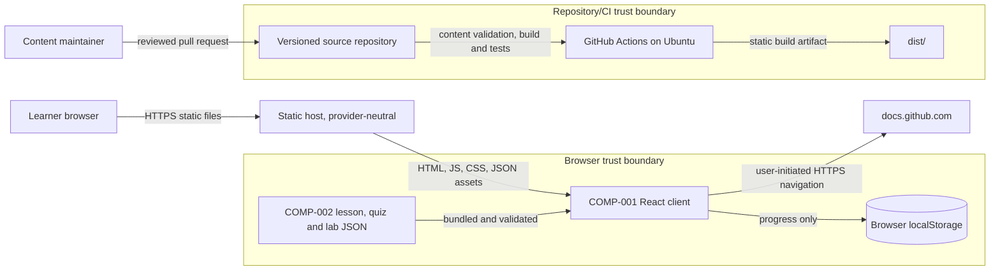
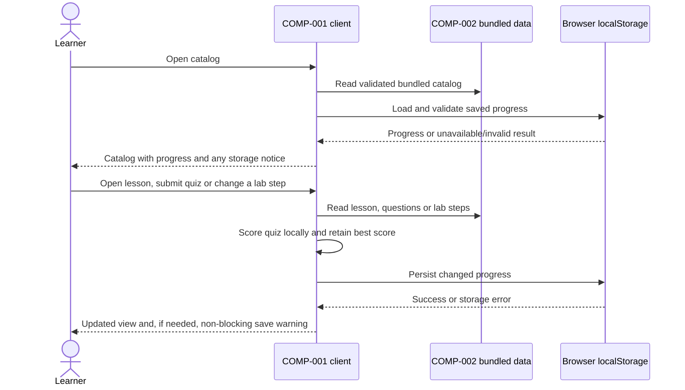

# High-Level Design (HLD)

| Field | Value |
| --- | --- |
| Application / Version / Date / Author | Copilot Agentic AI Academy / 1.0 / 2026-10-16 / 2-plan-and-design-agent |
| BRD reference | `docs/requirements/BRD.md` v1.0 (draft for writer review); source of scope: root issue #2 |

## 1. Design Overview & Goals

The application is a static, client-side learning experience for developers
learning about agentic AI and GitHub Copilot. It provides an ordered five-lesson
catalog, lesson viewers, three-question quizzes, a manual guided lab, and a
progress summary. The five lesson estimates plus the lab estimate must total
under 60 minutes. Its goals are keyboard-accessible use, safe rendering,
same-device progress persistence, low shipped asset size, and maintainable
versioned curriculum content.

The design uses a small React and TypeScript application built to static files.
It has no server, account, secrets, runtime API integration, telemetry, or
learner identity collection. Repository content is bundled with the application;
progress stays in the browser's local storage. The BRD is marked draft for writer
review, so it is cited as a design input rather than represented as accepted.
The root issue contains the scope and deferred decisions addressed here.

Explicit exclusions are user accounts, server-side or cross-device progress,
LLM/GitHub API calls, live Copilot integration, authoring UI, analytics,
certificates, payments, localization, and deployment configuration.

## 2. Architecture Diagram



The runtime flow is browser-to-static-host only for application assets. The app
does not fetch lesson content or send progress to a service. Documentation links
are ordinary user-initiated navigations and are not required for the app to
function.

## 3. System Components

| ID | Responsibility | Technology | Requirement IDs | LLD |
| --- | --- | --- | --- | --- |
| COMP-001 | Accessible catalog, lesson, quiz, lab and progress views; navigation; quiz scoring; local progress lifecycle | React, TypeScript, browser APIs | BRD-FR-001–006, BRD-FR-008–010; BRD-NFR-001–006, BRD-NFR-009; BRD-INT-001 | [client-application.md](LLD/client-application.md) |
| COMP-002 | Versioned lesson, quiz and lab data; schema and content invariants; safe content/link contract | JSON, TypeScript validation and automated tests | BRD-FR-007–009; BRD-NFR-008; BRD-INT-001 | [curriculum-content.md](LLD/curriculum-content.md) |
| COMP-003 | Reproducible validation, build and test of static output; CI quality and security gates | Node.js/npm, GitHub Actions, TypeScript CodeQL or documented alternative | BRD-FR-007, BRD-FR-010; BRD-NFR-002, BRD-NFR-005–007, BRD-NFR-009 | [curriculum-content.md](LLD/curriculum-content.md) |

COMP-003 is a repository build/verification responsibility, not a runtime
service. The static hosting provider remains unselected and deployment remains
out of scope.

## 4. Component Interactions

### Learner flow



Content is validated during tests/build and again at the application boundary
before rendering. Invalid bundled content is a build/test failure; if it
nevertheless reaches the browser, the app shows a safe unavailable-content state
instead of interpreting it as markup.

The quiz scorer is a pure function. Submission displays correctness and each
question's explanation; retry clears only the current answers/feedback. The
best-score update is `max(previousBest, currentScore)` and does not affect lesson
completion or lab steps. Reset requires browser confirmation, then removes the
app's progress key only.

## 5. Data Flow & Lifecycle

* **Curriculum:** JSON files are version-controlled, reviewed through pull
  requests, schema-validated in tests, bundled at build time, and publicly
  served as static assets. Content contains no learner data or executable HTML.
  Lesson and lab estimates together remain under 60 minutes.
* **Learner state:** `academy-progress/v1` in local storage contains completed
  lesson IDs, per-lesson best scores (0–3), and completed lab-step IDs. It is
  owned by the browser user on that device, has no expiry or remote copy, and is
  deleted only by the confirmed reset or browser storage clearing.
* **Runtime data flow:** User actions update in-memory state and then local
  storage. No progress or identity data leaves the browser.
* **Schema evolution:** The storage key includes its schema version. The first
  release reads only v1; incompatible or malformed data is not migrated
  implicitly. Show a recovery notice and initialize an in-memory empty state;
  the next successful user save replaces the app's key. A future version must
  specify and test an explicit migration before changing the schema.
* **Deletion:** Reset deletes only `academy-progress/v1`; it does not modify
  content or other origin storage.

## 6. External Integrations & Resilience

There are no runtime service integrations, authentication, API quotas, retries,
or service credentials. The only external destinations are user-activated HTTPS
links to official GitHub documentation. Link unavailability does not prevent
offline use of bundled lesson, quiz, and lab content.

Static asset loading failure is handled by the browser; the built application
contains all required content and does not make a runtime API call. If local
storage is unavailable, progress controls remain usable for the current page
session and a visible, accessible notice explains that changes cannot persist.
Storage errors never cause quiz scoring or content rendering to fail.

Build/test and asset-size failures block CI. The bootstrap stage must define a
repeatable initial-load measurement and record browser/network conditions for
the under-two-second target; measure the production output's total transferred
asset bytes excluding images against the 500 KB target. The measurement method
must not silently redefine either BRD target.

## 7. Architecture / Stack Decision

| Layer / decision | Alternatives | Selected technology / version | Rationale / trade-offs |
| --- | --- | --- | --- |
| Language / runtime | Plain JavaScript; HTML with no build; React with TypeScript | TypeScript 5.x; Node.js 22 LTS for build/test | Static typing helps keep content and persisted state contracts explicit. Node is build/test-only; browsers run the compiled client. Bootstrap pins exact patch versions in the lockfile and runner setup. |
| UI / routing | Plain DOM; React; other SPA framework | React 19.x; small hash-based route map, no routing package | Familiar component model supports consistent accessible views while avoiding server routing and an extra runtime dependency. Hash routes work on generic static hosts. |
| Bundler / styles | No bundler; other build tools | Vite 6.x; semantic HTML and local CSS | Small static output and standard TypeScript development/build workflow. Keep styles external to support strict CSP. |
| Content / persistence | Markdown plus parser; JSON; remote data; server storage | Structured JSON bundled at build; browser localStorage | JSON provides explicit fields and avoids Markdown/HTML parsing; localStorage meets same-device persistence without a backend. |
| Package management | npm, pnpm, yarn | npm with committed `package-lock.json` | Standard GitHub-hosted runner support and deterministic `npm ci`. |
| Tests / quality | Browser-only manual checks; Jest or Vitest; framework-specific checks | Vitest 3.x, React Testing Library, jsdom; TypeScript `tsc --noEmit`; ESLint | Test pure scoring/storage/content functions and keyboard-operated views without external services. Add the chosen exact versions during bootstrap. |
| Security / supply chain | CodeQL and npm advisories; alternatives documented by policy | CodeQL JavaScript/TypeScript when enabled; `npm audit` plus applicable dependency review policy | Analyze application TypeScript and npm dependencies. Respect repository entitlement variables and policies; template Python checks do not scan this app. |
| Test evidence | Process exit only; JUnit output | `test-results/junit.xml`, `minimum_tests: 15` non-skipped cases | Positive count makes the configured test gate require fresh JUnit evidence. Fifteen provides a minimum floor across quiz, progress, validation and representative UI cases; bootstrap adds tests for all acceptance criteria. |

### Source layout and runner

Bootstrap should use distinct application roots, for example:

```text
src/
  app/                 # routes, shell and accessible views
  domain/              # quiz scoring and progress model
  storage/             # localStorage adapter
  content/             # imported JSON and validator
content/
  lessons/             # ordered lesson and quiz JSON
  lab/                 # guided lab JSON
tests/
  unit/                # domain, storage and content validation
  components/          # keyboard and interaction behavior
```

Keep the actual application source roots outside template-owned directories.
Use `ubuntu-latest` and Node.js 22 LTS. `npm ci` installs the lockfile exactly;
CI build/test execution must not call external AI or GitHub APIs. Registry access
needed to install dependencies is separate from app/test execution; CI should
cache dependencies where available but must not treat a cache as test evidence.

Expected configured commands are `npm ci`, `npm run build`, `npm run lint`,
`npm run typecheck`, `npm run test:ci` (fresh JUnit at the path above), and
`npm audit` plus the repository's applicable dependency
review control. The bootstrap PR must provide real scripts, lockfile, report
generation, configured toolchain contract and runnable test evidence; these
commands are design expectations, not a claim that the app toolchain already
exists.

The application is JavaScript/TypeScript for CodeQL language selection and uses
the npm ecosystem for dependency review. Set both
`SDLC_CODEQL_ENABLED` and `SDLC_REQUIRE_DEPENDENCY_REVIEW` to their exact
entitled `true` or `false` values at bootstrap. Prefer enabled controls where
available. False values require the repository's corresponding documented
alternative and do not remove stable policy checks. If TypeScript CodeQL is not
available or enabled, bootstrap must select and document a real alternative
application scanner; Ruff S covers template Python only.

## 8. Deployment & Operations Architecture

Local development and CI produce a static `dist/` artifact; no deployment is
part of this run. The artifact can be published by a future static host without
an application server. A chosen host must serve HTTPS and the built entry point
for the selected hash routes.

No application configuration, environment secrets, database, health endpoint,
backup process, monitoring, or rollback mechanism exists or is required for the
static app. Release and rollback are provider-specific and remain disabled until
a provider and protected publishing process are explicitly selected. Preserve
the previous static artifact for rollback when that future process is defined.

## 9. Security Considerations

* **Trust boundaries:** The repository/CI pipeline supplies public bundled
  content and built code; the browser is the only runtime execution boundary.
  External documentation is navigated to only by explicit learner action.
* **Content safety:** Never use `dangerouslySetInnerHTML`, `innerHTML`, or an
  executable-content parser. Render typed text/heading/list/code/link nodes as
  framework-escaped text. Validate all external content links as HTTPS
  `docs.github.com` URLs. Do not permit arbitrary HTML or script blocks in data.
* **Browser policy:** Keep scripts and styles in same-origin built files. Use a
  restrictive policy such as `default-src 'self'; script-src 'self';
  style-src 'self'; connect-src 'none'; img-src 'self'; object-src 'none';
  base-uri 'self'; form-action 'self'`. A host-level `frame-ancestors 'none'`
  header is required because that directive is not supported by a CSP meta
  element. No inline script/style exceptions, `eval`, or runtime API origins.
* **Privacy:** Persist only the specified progress IDs and numeric scores under
  the app origin. No cookies, identifiers, analytics, network submission, or
  sensitive data.
* **Storage integrity:** Validate local storage shape and IDs before use;
  constrain scores to integers 0–3; catch access/quota errors and disclose
  non-persistence accessibly.
* **Supply chain:** Minimize runtime dependencies, commit the npm lockfile, use
  dependency review/advisories as entitled, and scan TypeScript with CodeQL or
  a documented equivalent. Do not embed credentials or require secrets.
* **Accessibility and abuse resistance:** Use semantic landmarks, labelled
  controls, visible focus, keyboard operation, and safe link destinations.
  External links do not run app actions.

## 10. Design Decisions & Trade-offs

| ID | Decision | Options | Chosen approach | Consequences |
| --- | --- | --- | --- | --- |
| DD-001 | Client stack | Plain HTML/TypeScript; React/TypeScript; other framework | React 19 with TypeScript 5 and Vite 6 | Widely used, testable component model; adds a small dependency footprint that must meet the asset budget. |
| DD-002 | Content representation and rendering | Markdown/front matter; HTML; structured JSON | JSON with typed content blocks; render through escaped React text nodes | Slightly more verbose for maintainers, but avoids parser/HTML injection risk and makes required fields testable. |
| DD-003 | Navigation and hosting | Server routes; router dependency; hash routes | Hash routes without routing dependency | Works on generic static hosts and supports browser navigation; route state is less descriptive than path URLs. |
| DD-004 | Progress persistence | Server account; cookies; browser local storage | Versioned localStorage record only | Meets same-device privacy requirement; browser clearing/unavailability can lose persistence and is disclosed. |
| DD-005 | Test gate evidence | Exit status; generated test report | JUnit XML with at least 15 non-skipped cases | Allows the repository toolchain to reject stale/zero-test success; bootstrap must configure the reporter and test gate. |
| DD-006 | Deployment and security gates | Configure provider and entitlements now; defer administration | Produce static artifact only; retain documented dependency/code scanning gates and explicit entitlement decisions | No deployment or paid feature is presumed; bootstrap/repository writers must configure applicable controls. |

## 11. Traceability & Open Decisions

| BRD requirement | Component / control | LLD / verification |
| --- | --- | --- |
| KPI-001 | COMP-002 lesson and lab estimates | [Content](LLD/curriculum-content.md); validate the five lesson estimates plus the lab estimate total under 60 minutes. |
| KPI-002 | COMP-002 curriculum; COMP-001 learner flow | Both LLDs; review coverage of the issue → agent → PR → review → human merge loop and human responsibilities. |
| KPI-003 | COMP-001 local progress | [Client](LLD/client-application.md); verify progress survives reload on the same device. |
| BRD-FR-001 | COMP-001 catalog and ordered COMP-002 dataset | [Client](LLD/client-application.md); [content](LLD/curriculum-content.md); exactly five entries and catalog fields tested. |
| BRD-FR-002 | COMP-001 viewer/navigation/completion | [Client](LLD/client-application.md); supported block render and boundary navigation tests. |
| BRD-FR-003 | COMP-001 pure quiz scorer and feedback | [Client](LLD/client-application.md); score, 2/3 threshold, explanations, retry and best-score tests. |
| BRD-FR-004 | COMP-001 guided lab; COMP-002 lab data | [Client](LLD/client-application.md); five manual steps, official links, no automation. |
| BRD-FR-005 | COMP-001 local progress adapter and views | [Client](LLD/client-application.md); reload persistence and non-decreasing best score. |
| BRD-FR-006 | COMP-001 confirmed reset | [Client](LLD/client-application.md); cancel preserves state; confirm removes only the app key. |
| BRD-FR-007 | COMP-002 schemas and COMP-003 CI tests | [Content](LLD/curriculum-content.md); missing fields, duplicate IDs and invalid correct-answer counts fail. |
| BRD-FR-008 | COMP-001 semantic keyboard-accessible views | [Client](LLD/client-application.md); keyboard-only traversal and operation across all routes. |
| BRD-FR-009 | COMP-002 safe block/link contract and COMP-001 renderer | [Content](LLD/curriculum-content.md); hostile markup is treated as text and never executes. |
| BRD-FR-010 | COMP-003 isolated app/test commands | [Content](LLD/curriculum-content.md); CI build and tests run without external AI/GitHub API access. |
| BRD-NFR-001 | COMP-001 semantic interaction design | [Client](LLD/client-application.md); automated checks where supported plus manual keyboard/focus/contrast review. |
| BRD-NFR-002 | COMP-003 build budget and load measurement | [Content](LLD/curriculum-content.md); production asset size excludes images; record repeatable initial-load conditions. |
| BRD-NFR-003 | COMP-001 responsive layout | [Client](LLD/client-application.md); exercise all views at 360 px and desktop. |
| BRD-NFR-004 | COMP-001 local-only data flow | [Client](LLD/client-application.md); inspect storage and network activity for no progress transmission. |
| BRD-NFR-005 | COMP-001 CSP/safe rendering; COMP-003 scanning | Both LLDs; CSP compatibility, safe content tests and configured dependency/security gate. |
| BRD-NFR-006 | COMP-001 evergreen browser support | [Client](LLD/client-application.md); verify latest stable Chrome, Edge, Firefox and Safari at test time. |
| BRD-NFR-007 | COMP-003 test/lint/typecheck contract | [Content](LLD/curriculum-content.md); CI runs scoring, storage and content tests, lint and typecheck. |
| BRD-NFR-008 | COMP-002 conceptual content and official links | [Content](LLD/curriculum-content.md); review conceptual claims and HTTPS `docs.github.com` destinations. |
| BRD-NFR-009 | COMP-003 static output | [Content](LLD/curriculum-content.md); inspect `dist/` for static-hostable output; no deployment required. |
| BRD-INT-001 | COMP-001 has no runtime APIs; COMP-002 validates documentation links | Both LLDs; inspect network activity and validate link host/protocol. |

The BRD remains marked draft for writer review. Before implementation tasks
proceed, the repository writer must accept the BRD and any material change to
this design through the repository's normal review process. Performance/load
measurement conditions and actual security-product entitlement remain
bootstrap-time environment decisions; neither changes the stated acceptance
targets or authorizes weakening the gates.
