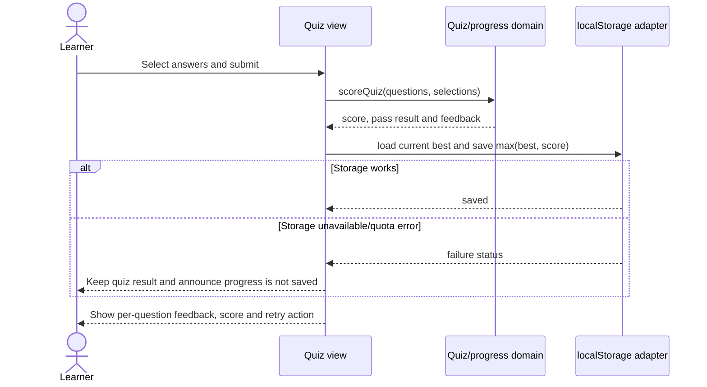
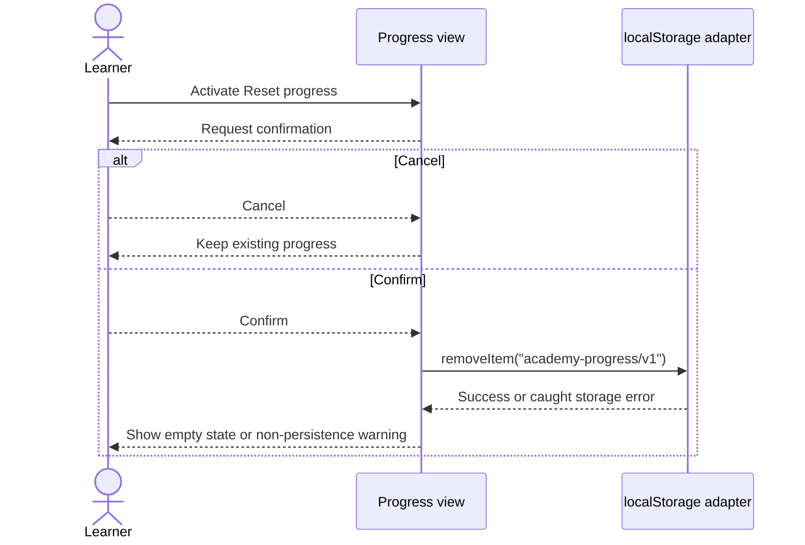

# Low-Level Design: Client Application

| Field | Value |
| --- | --- |
| Component / HLD ID | Client application / COMP-001 |
| Version / Date / Author | 1.0 / 2026-10-16 / 2-plan-and-design-agent |
| BRD references | BRD-FR-001–006, BRD-FR-008–010; BRD-NFR-001–006, BRD-NFR-009; BRD-INT-001 |

## 1. Component Purpose & Scope

Provide the browser UI, local navigation, quiz flow, progress display and
same-device progress lifecycle. This component is a static React/TypeScript
client with no backend or runtime service calls. Curriculum shape and
validation are specified in [Curriculum Content](curriculum-content.md).

Excluded: accounts, remote synchronization, GitHub/LLM API calls, deployment,
analytics and content editing.

## 2. Detailed Design

Suggested modules:

```text
src/app/                 application shell, hash routes, page views
src/domain/quiz.ts       pure score and pass calculation
src/domain/progress.ts   progress types, validation and update reducers
src/storage/progress.ts  localStorage read/write/reset adapter
src/components/          catalog, lesson, quiz, lab and progress components
```

Use hash routes `#/`, `#/lessons/<lesson-id>`, `#/lab`, and `#/progress`.
Internal navigation uses anchors so keyboard and browser back/forward work.
Unknown route or content ID renders an accessible not-found view with a catalog
link. Do not require server rewrites.

The catalog loads five ordered lesson records and shows title, summary, minutes,
and completion. The lesson view renders only the content block types defined by
COMP-002, has previous/next links (absent at boundaries), and an explicit
“Mark complete” control. The quiz view groups each question and answers in a
`fieldset`/`legend`, uses labelled radio controls, and reports per-question
correctness, explanation, score, and pass result after submission. Retry resets
only the current attempt. Lab checkboxes represent only manual learner actions;
they never call a GitHub service. Catalog and progress summary reflect saved
state.

### Domain contracts

* `scoreQuiz(questions, selectedOptionIds)` returns `{ score, total, passed,
  feedback }`; `passed` is `score >= 2` for the required three-question quiz.
  Missing selections are incorrect. The function performs no I/O.
* `updateBestScore(progress, lessonId, score)` stores the maximum of the old
  value and new score; valid score is an integer from 0 through 3.
* Completion and lab-step toggles add/remove known IDs only. Unknown IDs are
  rejected by the progress validator and are not rendered as completed.
* Route/view changes move focus to the new page's `h1` (programmatically
  focusable) and expose status/error updates through a polite live region.
* On storage read/write failure, keep current-session state in memory and show
  an accessible message that changes will not persist. Never fail the content
  or quiz operation because storage is unavailable.

## 3. Data Models

Persist under the single origin key `academy-progress/v1`:

```json
{
  "schemaVersion": 1,
  "completedLessonIds": ["lesson-agentic-ai"],
  "bestQuizScores": { "lesson-agentic-ai": 2 },
  "completedLabStepIds": ["lab-write-issue"]
}
```

Arrays contain unique IDs from validated bundled content. Score entries have
known lesson IDs and integer values 0–3. The reader validates version, object
shape, IDs, uniqueness, and score bounds before exposing state. Corrupt or
unsupported state is not trusted; render a recovery notice and use an empty
in-memory state. There is no implicit migration. Version changes require an
explicit migration design and tests.

The storage adapter exposes `loadProgress()`, `saveProgress(progress)` and
`resetProgress()`. It catches browser storage availability, serialization,
quota and security exceptions and returns an explicit success/failure result.
Reset confirmation is a UI responsibility; cancel performs no write. Confirm
deletes only this key. No sensitive or identifying data is stored.

## 4. Interface Specifications

| Operation / interface | Input | Output | Auth / errors | Compatibility |
| --- | --- | --- | --- | --- |
| `scoreQuiz` | Three validated question records; selected answer IDs keyed by question ID | Score, total, pass boolean, per-question feedback/explanation | No auth/I/O; invalid question input fails validation before scoring | Pure domain function; v1 quiz contract |
| `loadProgress` | None; reads `academy-progress/v1` | Valid progress or empty initial state plus recovery/storage status | No auth; missing key is first-use state; malformed/unavailable storage returns status, not throw | Local schema v1 |
| `saveProgress` | Validated progress object | Success/failure result | No auth; serialization/quota/security failures caught and surfaced | Writes only v1 key |
| `resetProgress` | None, invoked only after confirmation | Success/failure result | No auth; removes only app progress key | Does not alter other origin storage |
| `toggleLessonCompletion` | Existing lesson ID and current state | Updated state, idempotent set membership | Reject unknown ID | UI domain operation |
| `toggleLabStep` | Existing lab step ID and current state | Updated state, idempotent set membership | Reject unknown ID; never invokes GitHub | UI domain operation |
| Hash route | `#/`, `#/lessons/<id>`, `#/lab`, `#/progress` | Corresponding view or accessible not-found view | No auth; unknown route does not crash | Static-host compatible |

## 5. Sequence Diagrams

### Submit quiz and persist best score



### Reset progress



## 6. Error Handling & Logging

No remote logging or telemetry. Errors are handled locally and do not include
learner state in console output:

* Missing/invalid content: safe unavailable-content state; build/test should
  normally fail before release.
* Missing route/record: accessible not-found state with navigation back.
* Storage unavailable or quota/security exception: preserve in-memory operation
  and announce non-persistence; do not silently claim saved state.
* Corrupt or future-version progress: ignore untrusted record, explain recovery,
  and start in-memory empty state. Replace it only on a later explicit save.
* Invalid answer selection: treat unanswered question as incorrect; validate
  question IDs before calculation.

No retries, timeouts, correlation IDs or service idempotency are needed because
the component performs no network operation. Set updates are idempotent.

## 7. Configuration & Environment

| Variable / setting | Purpose | Required? | Safe default / secret source |
| --- | --- | --- | --- |
| Node.js 22 LTS | Build and test runtime only | CI/local development | `.nvmrc` or equivalent pinned major; no secret |
| Browser origin | Scopes localStorage and same-origin CSP | Runtime | Current static-host origin; no secret |
| `academy-progress/v1` | Versioned local progress key | Runtime | Empty first-use state; no secret |
| CSP response policy | Restrict script, style, connections and embedding | Hosting setup | Same-origin sources only; host adds `frame-ancestors 'none'`; no secret |

## 8. Dependencies

* React 19.x and React DOM 19.x for UI.
* TypeScript 5.x for static contracts.
* Vite 6.x for build and local development.
* Browser `localStorage`, `history`, and `URL` APIs; no application runtime
  service or secrets.
* Vitest 3.x and React Testing Library with jsdom for tests; exact patch versions
  are selected and locked by bootstrap.

No router, Markdown parser, HTML sanitizer, analytics, state-management package,
or remote API SDK is required.

## 9. Traceability & Verification

| Element | Component | BRD ID | Test approach |
| --- | --- | --- | --- |
| Catalog fields/order and lesson navigation | COMP-001 | BRD-FR-001, BRD-FR-002 | Assert five ordered entries, required fields and previous/next boundaries. |
| Quiz scoring, threshold, feedback and retry | COMP-001 | BRD-FR-003 | Unit test 0/3, 1/3, 2/3 and 3/3; unanswered answers; explanation visibility; retry behavior. |
| Lab manual checklist | COMP-001 | BRD-FR-004 | Verify all five manual actions are checkable and no action invokes a service. |
| Progress persistence and summary | COMP-001 | BRD-FR-005 | Save, reload adapter/view, verify lesson/quiz/lab state and best-score monotonicity. |
| Confirmed reset | COMP-001 | BRD-FR-006 | Cancel preserves state; confirm removes app key; storage failure is announced. |
| Keyboard access and responsive views | COMP-001 | BRD-FR-008; BRD-NFR-001, BRD-NFR-003 | Keyboard-only operation; labels/focus/landmarks; manual 360 px and desktop review. |
| Safe render and network privacy | COMP-001 | BRD-FR-009, BRD-NFR-004, BRD-NFR-005, BRD-INT-001 | Render hostile text as inert text; inspect app network for no API/progress requests; validate CSP. |
| Browser support and static use | COMP-001 | BRD-NFR-006, BRD-NFR-009 | Latest stable Chrome, Edge, Firefox, Safari; static host/hash-route smoke test. |
